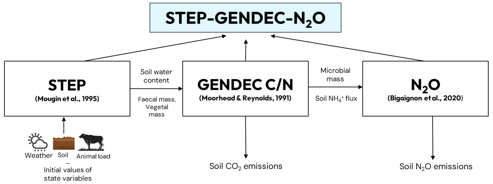
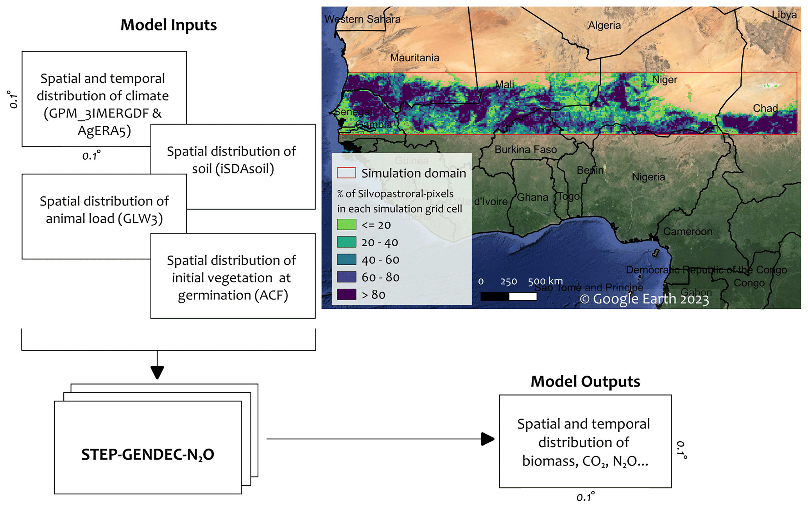
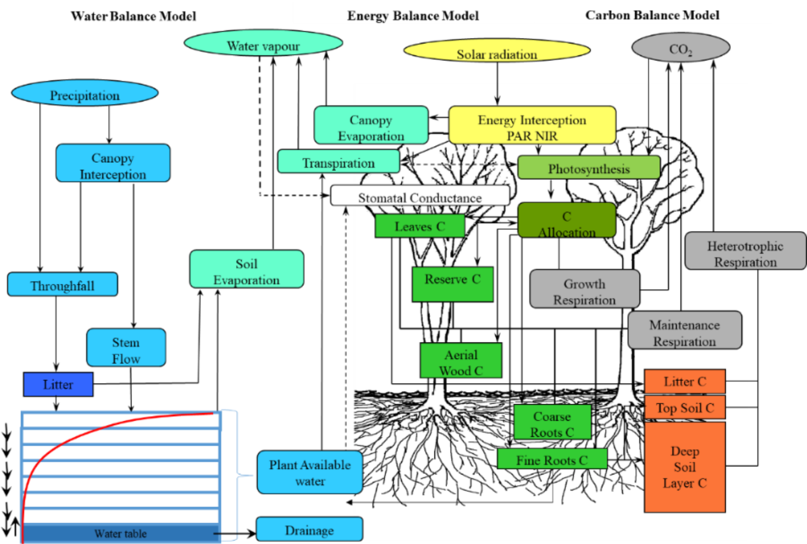
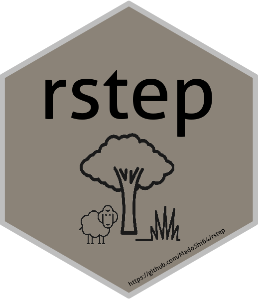
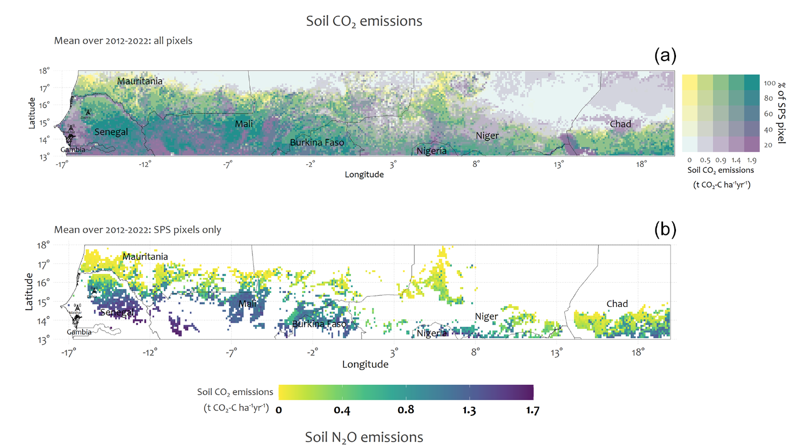
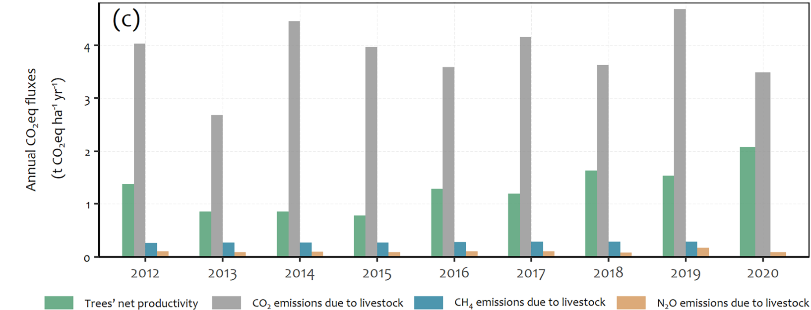
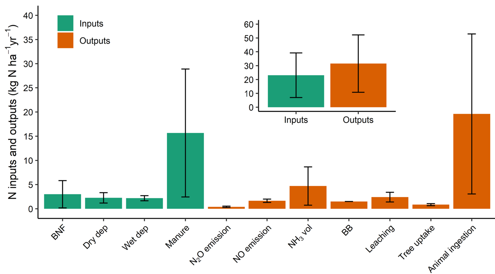

  
Models I use, and my custom codes and package

  
Table of Contents ➤

  

    <ul>
      <li><a href="#model">Models I use</a></li>
      <li><a href="#rpackage">R package I developed</a></li>
      <li><a href="#custom-code">My scripts</a></li>
    </ul>
  

---

### <a id="model">Models I use 🔄</a>

  

    
<a href="https://zenodo.org/record/7973200">1D-STEP-GENDEC-CN</a> simulates in Sahelian herbaceous savannas the water, C and N cycling between the atmosphere, vegetation, and soil

  

  

    
  

  

    
<a href="https://zenodo.org/record/7866674">2D-STEP-GENDEC-CN</a> is the spatialized version of 1D-STEP-GENDEC-CN

  

  

    
  

  

    
<a href="https://vezy.github.io/DynACof/">DynACof:</a> The Dynamic Agroforestry Coffee Crop Model, is a generic tree-growth model 

  

  

    
  

  

    
<a href="https://stics.inrae.fr/">STICS:</a> Simulateur mulTIdisciplinaire pour les Cultures Standard (Multidisciplinary simulator for standard crops)

  

  

    
  

  

    
<a href="https://www.ipef.br/publicacoes/stecnica/nr48/ipef-sertec-48-109.pdf">Castanea-Maespa</a> is a coupled model that simulates carbon, water and energy balances of a monospecific forest stand.

  

  

    
  

---

### <a id="rpackage">R package I developed 📊</a>

  

    
<a href="https://github.com/fredi-agbohessou/rstep">rstep</a> is a workflow package that I developed to perform STEP-GENDEC-CN model simulations within the RStudio environment

  

  

    
  

---

### <a id="custom-code">My scripts 📄</a>

  

    
<a href="https://github.com/fredi-agbohessou/my_scripts/tree/main/BG_Agbohessou_et_al_2024/data_extraction_processing_and_mapping">Codes [data extraction, processing and mapping in]</a>  "Modelling CO2 and N2O emissions from soils in silvopastoral systems of the West African Sahelian band (Agbohessou et al. 2024)"

  

  

    
  

  

    
<a href="https://github.com/fredi-agbohessou/my_scripts/tree/main/AFM_Agbohessou_et_al_2023">Codes [plots, sensitivity and uncertainty analysis in]</a>  "To what extent are greenhouse-gas emissions offset by trees in a Sahelian silvopastoral system? (Agbohessou et al. 2023)"

  

  

    
  

  

    
<a href="https://github.com/fredi-agbohessou/my_scripts/blob/main/code_delon_et_al_2022/plot_delon_et_al_2022.R">Codes [plots in]</a>  "Nitrogen budget and critical load determination at a Sahelian grazed grassland site (Delon et al. 2022)"

  

  

    
  

