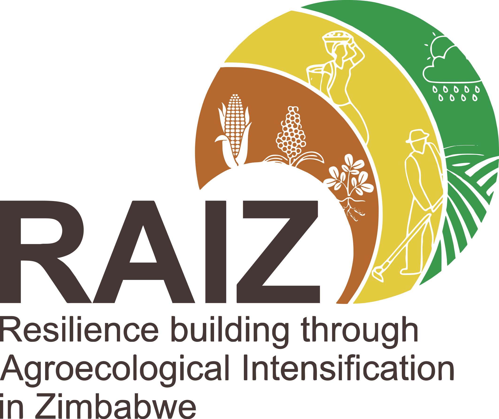
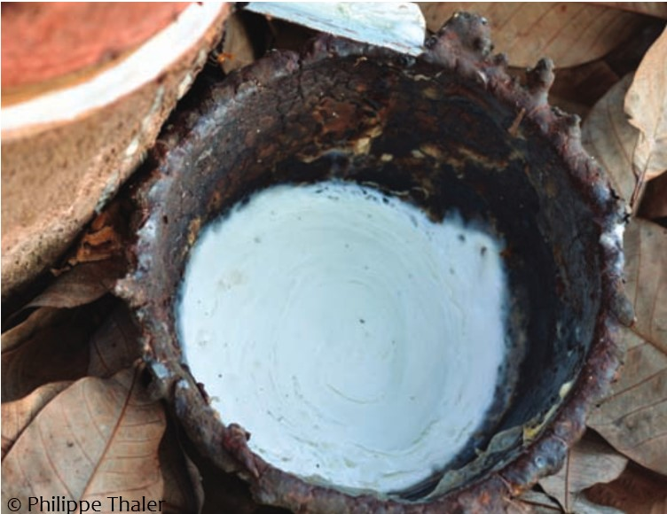
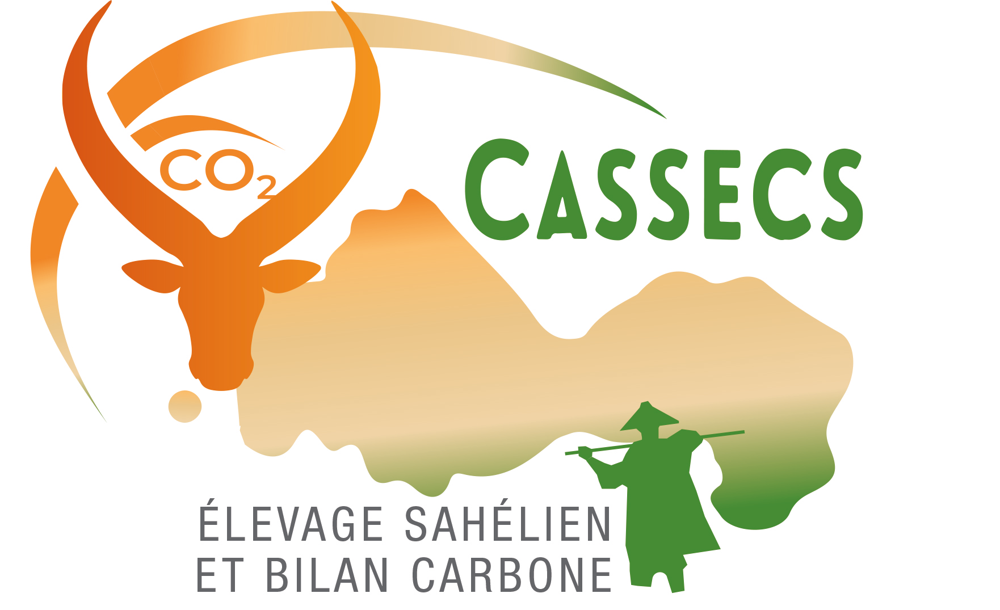
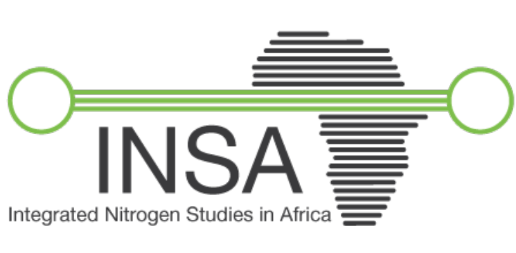
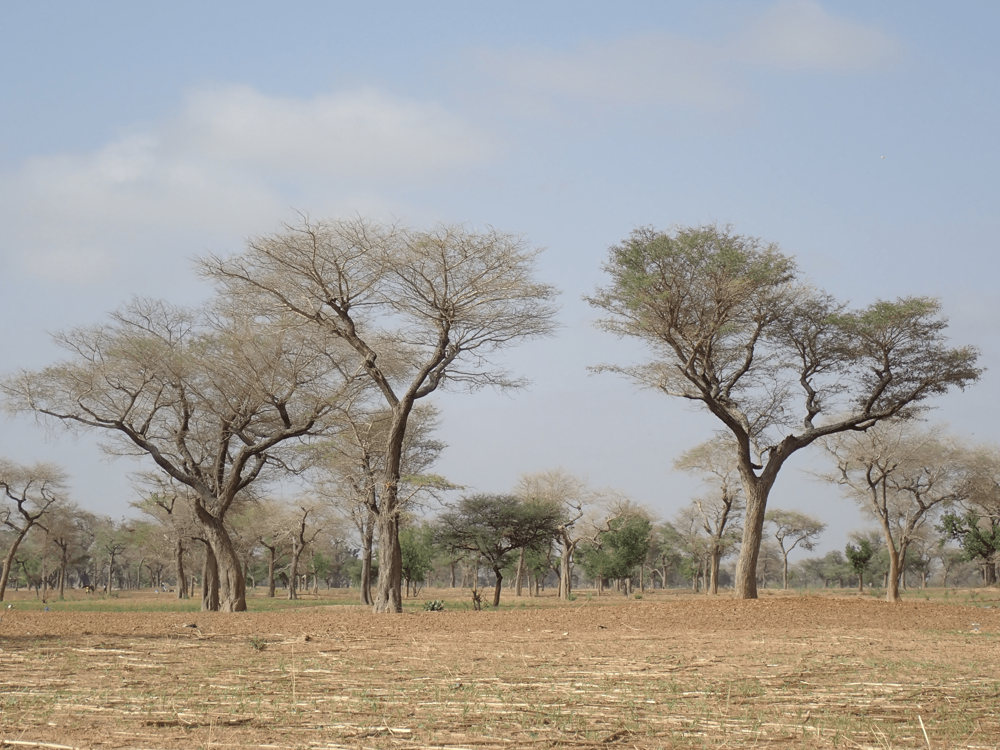

  
Current and past projects I have been involved in

---

  

    
<a href="https://raiz.org.zw/">RAIZ:</a> Resilience building through Agroecological Intensification in Zimbabwe

  

  

    
  

  

    
<a href="https://www.cirad.fr/dans-le-monde/cirad-dans-le-monde/projets/projet-forsea">FORSEA:</a> Forecasting impacts of climate change and workforce availability on natural rubber commodity chain in South-East Asia

  

  

    
  

  

    
<a href="https://www.cassecs.org/">CASSECS:</a> Carbon Sequestration and Greenhouse Gas Emissions in (Agro) Sylvopastoral Ecosystems in the Sahelian CILSS States

  

  

    
  

  

    
<a href="https://h2020-insa.aeris-data.fr/">INSA:</a> Integrated Nitrogen Studies in Africa 

  

  

    
  

  

    
<a href="https://leap.iamb.it/?page_id=287">RAMSES II:</a> Roles of Agroforestry in sustainable intensification of small farms and food security for societies in West Africa

  

  

    
  

---